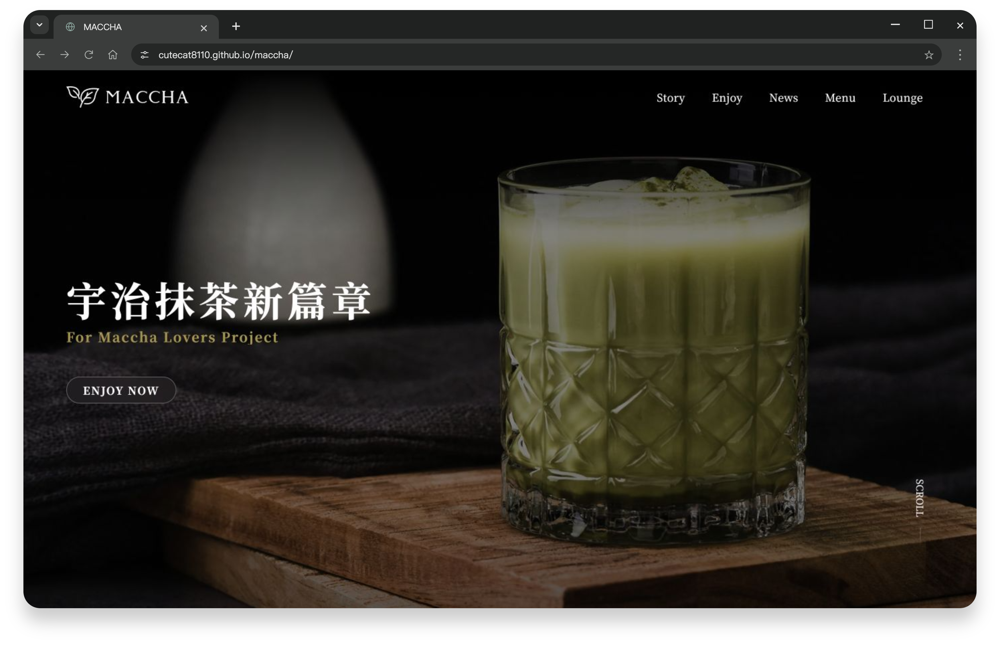

# MACCHA - 抹茶形象官網


> 以抹茶為主題的形象網站，透過暗色視覺、捲動動畫與飲品甜點菜單呈現品牌氛圍。



## 📋 專案概述

此專案從企劃、設計到前端皆獨立開發，使用 Vue、TypeScript 與 Tailwind CSS。以 RWD 響應式設計為基礎，結合章節導覽、輪播、捲動動效與店鋪地圖，呈現網站設計及前端開發能力。

**[Demo](https://cutecat8110.github.io/maccha/)** · [設計稿](https://www.figma.com/design/cIh6r51LX2ZPM78ezNH4YR/Maccha?node-id=0-1&t=pVNl1J6qQyzy6WAS-1)

## 🔨 核心技術

<table>
    <tbody>
    <tr>
        <td>
        <a href="https://vuejs.org/"> Vue 3 </a>
        </td>
        <td>JavaScript 框架</td>
    </tr>
    <tr>
        <td>
        <a href="https://www.typescriptlang.org/"> TypeScript </a>
        </td>
        <td>JavaScript 的超集</td>
    </tr>
    <tr>
        <td>
        <a href="https://tailwindcss.com/"> Tailwind CSS </a>
        </td>
        <td>CSS 框架</td>
    </tr>
    </tbody>
</table>

## 🛠️ 擴展套件

<table>
    <tbody>
        <tr>
            <td>
                <a href="https://vueuse.org/"> VueUse </a>
            </td>
            <td>Vue 3 Composition API 的實用函數庫</td>
        </tr>
        <tr>
            <td>
                <a href="https://swiperjs.com/"> Swiper </a>
            </td>
            <td>輪播/滑動組件</td>
        </tr>
        <tr>
            <td>
                <a href="https://greensock.com/gsap/"> GSAP </a>
            </td>
            <td>高效動畫庫，創建平滑動畫效果</td>
        </tr>
        <tr>
            <td>
                <a href="https://www.npmjs.com/package/@googlemaps/js-api-loader">Google Maps JavaScript</a>
            </td>
            <td>輕鬆載入地圖功能</td>
        </tr>
        <tr>
            <td>
                <a href="https://vcalendar.io/">v-calendar</a>
            </td>
            <td>功能豐富的日曆和日期選擇組件</td>
        </tr>
        <tr>
            <td>
                <a href="https://vee-validate.logaretm.com/v4/">vee-validate</a>
            </td>
            <td>簡化表單驗證的 Vue.js 庫</td>
        </tr>
        <tr>
            <td>
                <a href="https://day.js.org/">dayjs</a>
            </td>
            <td>輕量級日期處理庫</td>
        </tr>
        <tr>
            <td>
                <a href="https://michalsnik.github.io/aos/">AOS</a>
            </td>
            <td>捲動動畫庫，滾動時觸發動畫效果</td>
        </tr>
    </tbody>
</table>

## 🌸 啟動指南

使用 `.node-version` 指定的 Node 22.23.3：

```sh
npm ci
npm run dev
```

## 使用說明

聯絡表單僅驗證輸入，不寄信、訂位或保存資料。新聞卡片與 VIEW ALL 為靜態展示。地圖載入失敗時可使用位置連結。

<details>
<summary>測試、部署與維護</summary>

使用 `.node-version` 指定的 Node 22.23.3：

```bash
npm ci
npm run dev
npm test
npm run type-check
npm run lint
npm run build
npm run preview -- --host 127.0.0.1
```

- 網站使用 `/maccha/` 路徑，正式產物輸出至 `docs/`；GitHub Pages 使用 `main` 分支的 `/docs`。
- `VITE_API_KEY` 為 Google Maps **瀏覽器用** API key，會進入公開產物；應在 Google Cloud 限制網站來源與可使用的 API。不要在任何 `VITE_*` 變數放入伺服器秘密。現有地圖設定沿用，沒有更動帳務或配額。
- 本機可用 `.env.local` 覆寫地圖設定；未設定 key 或 SDK 載入失敗時提供位置連結。測試會 mock 地圖 SDK，不呼叫 Google API。
- 聯絡表單原本只驗證輸入並關閉，沒有寄信、訂位或後端儲存；新聞卡片與 VIEW ALL 也保留原有展示行為。
- 保留原字型、圖片及裁切方式。非首屏圖片延後載入，地圖接近店鋪區時才初始化。
- `src/assets/fonts/*-site.woff2` 由原字型建立常用字集；完整 TTF 保留作為其他輸入字元的備援。修改網站文案後，可於安裝 `fonttools[woff]` 的 Python 環境執行 `python qa/build-font-subsets.py`，再重新 build。腳本及產物已提交，一般啟動不需要 Python。

### 素材維護

原始圖片與設計保留，網站引用預先產生的 WebP。更新原圖後，以 Node 22 執行 `npm ci`、`npm run images:optimize`；一併提交 WebP 與 `qa/image-sizes.json`，一般發布不會即時轉圖。圖片來源與輸出清單在 `scripts/image-sources.json`。之後執行原本的 `npm run build`，同步發布 `docs/`。

</details>
